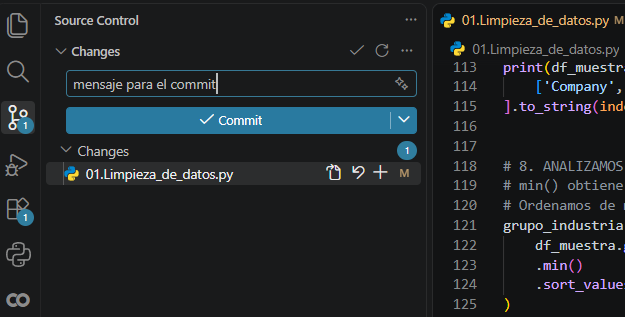
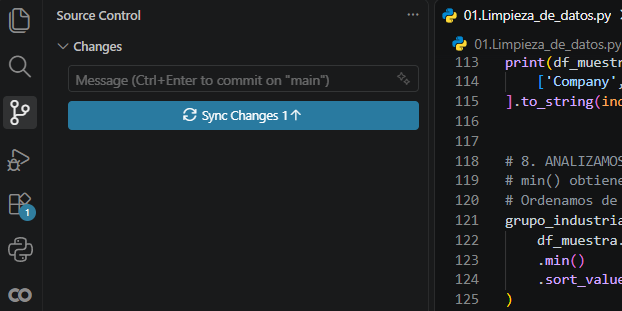

# Guía de Git para trabajar en equipo con GitHub y VS Code

Esta guía explica cómo **actualizar tu repositorio antes de trabajar** y cómo **guardar y subir los cambios a GitHub** de dos maneras: con comandos en la terminal o desde la interfaz de Visual Studio Code.

> Cada vez que abras el proyecto para trabajar, haz primero `git pull` para incorporar los cambios de tus compañeros. Antes de subir tus cambios, asegúrate de estar sincronizado con la rama remota.

## 1. Antes de empezar: actualizar el proyecto

1. Abre la carpeta del repositorio en **VS Code**.
2. Abre **Terminal → Nuevo terminal**.
3. Descarga e integra los últimos cambios de esa rama:

   ```bash
   git pull
   ```

4. Ahora ya puedes modificar archivos, crear carpetas o añadir código.Y para incorporarlo al proyecto
   

**Importante:**  Si dos personas modifican las mismas líneas pueden producirse conflictos que habrá que resolver. Si tienes cambios locales sin guardar en un commit, conviene revisarlos antes de hacer `pull`.

---

## 2. Opción A: subir cambios desde la terminal

Una vez que hayas terminado los cambios, abre la terminal integrada de VS Code y ejecuta:

### Paso 1. Revisar qué ha cambiado

```bash
git status
```

### Paso 2. Preparar los archivos modificados

```bash
git add .
```

El punto (`.`) significa que se añaden los cambios de la carpeta actual y sus subcarpetas. 

### Paso 3. Crear un commit con un mensaje descriptivo

```bash
git commit -m "Añadir gráficos al proyecto"
```

Cambia el texto del ejemplo por una descripción de lo que realmente has hecho.

### Paso 4. Subir los cambios a GitHub

```bash
git push
```

Si otra persona ha subido nuevos commits antes que tú, Git puede rechazar el `push`. En ese caso, integra primero los cambios remotos con `git pull`, resuelve los conflictos si aparecen y vuelve a ejecutar `git push`.

**Resumen de comandos:**

```bash
# Al comenzar a trabajar
git pull

# Después de editar los archivos
git status
git add .
git commit -m "Describir los cambios realizados"
git push
```

---

## 3. Opción B: subir cambios con los botones de VS Code

**Primero actualiza el repositorio.** Puedes hacerlo desde **Terminal → Nuevo terminal** ejecutando `git pull` (o desde el menú `…` del panel de Control de código fuente, usando la opción **Pull / Extraer**, según tu versión de VS Code).

### Paso 1. Abrir Control de código fuente

Haz clic en el icono **Control de código fuente** de la barra lateral izquierda (el símbolo de una rama de Git). Allí aparecen los archivos modificados.

### Paso 2. Preparar los cambios y escribir el mensaje del commit

1. En **Cambios**, pulsa el **`+`** de cada archivo o el **`+`** del apartado para preparar todos los archivos que quieras incluir.
2. En el cuadro de texto de la parte superior, escribe el **mensaje del commit**. Ejemplo: `Añadir limpieza de datos y gráficos`.
3. Pulsa **Confirmar** (*Commit*).




### Paso 3. Sincronizar los cambios con GitHub

Después de confirmar el commit, pulsa **Sincronizar cambios** (*Sync Changes*). Según la configuración, puede verse como un botón en el panel, como flechas circulares en la barra inferior o dentro del menú `…` de Control de código fuente.



Sincronizar normalmente **obtiene e integra cambios remotos y después envía tus commits locales**. No equivale únicamente a `git push`. Si aparecen conflictos o una solicitud de confirmación, revísalos antes de continuar.

---

## 4. ¿Qué opción usamos?

| Con terminal | Con interfaz de VS Code |
| --- | --- |
| `git pull` antes de trabajar | **Pull / Extraer** antes de trabajar |
| `git add .` | Pulsar **`+`** para preparar archivos |
| `git commit -m "Mensaje"` | Escribir el mensaje y pulsar **Confirmar** |
| `git push` | Pulsar **Sincronizar cambios** |

**No es necesario hacer las dos opciones seguidas.** Son dos formas de realizar el mismo flujo básico. Cada miembro del equipo puede elegir la que le resulte más cómoda.

